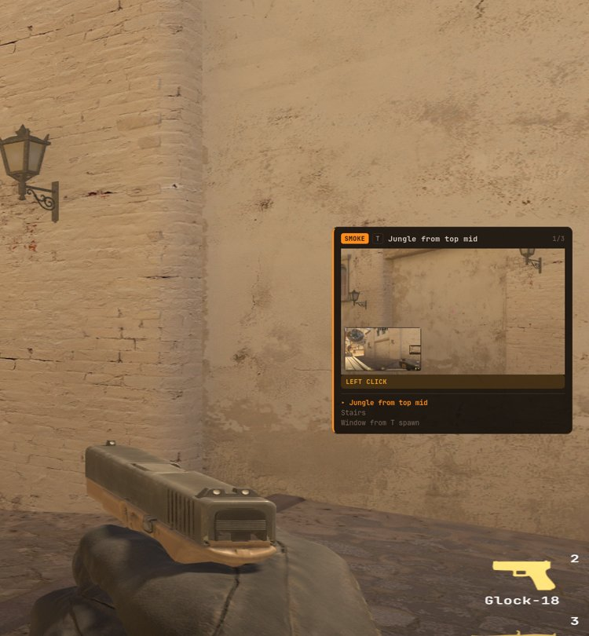

# nadecue

[](https://github.com/Tjabooo/nadecue/actions/workflows/ci.yml) [](https://github.com/Tjabooo/nadecue/releases) [](LICENSE)

Your CS2 grenade lineups on screen the moment you pull out the grenade, gone the moment you throw it.



## Features

- **Automatic.** Hold a smoke on Mirage as T and the card shows your Mirage T smokes. Switch weapons
  or throw and it closes. Nothing is on screen the rest of the time.
- **The right one first.** The lineup you threw last time comes first (most players throw the same
  ones for their role every round). The strip under the picture lists the rest; `nadecue next` steps
  through them.
- **Ask for one by name.** `nadecue find mirage ct smoke from t spawn` (any word order, typos and
  speech-to-text spellings like "see tea" are fine) puts that lineup on the card now and first in
  line when you pull out the grenade. Made for voice assistants.
- **Save in one key press.** In practice mode, stand on the spot, aim, hold the grenade and run
  `nadecue save`. It stores a close-up of your crosshair (where to aim), the whole view (where you
  stand), the throw style, a name and an optional note.
- **Out of the way.** A small card on the right edge of the screen, no keyboard focus, no clicks.
  It only exists while a grenade with saved lineups is in your hand.
- **Plain files.** One JSON file and two PNGs per lineup, one folder per map. Copy, share or edit
  them by hand.
- **Fair play.** It only reads Valve's Game State Integration (the same feed used by HUDs and
  Discord status tools) and takes screenshots. It never reads game memory or sends input to the game.

## Install

Needs Linux on Wayland with [eww](https://github.com/elkowar/eww) (draws the card), grim
(screenshots), rofi (naming lineups when saving), notify-send and Rust to build.

```sh
git clone https://github.com/Tjabooo/nadecue
cd nadecue
./install.sh
```

The installer builds the binary into `~/.local/bin`, puts the card's eww config in
`~/.config/nadecue/eww`, writes `~/.config/nadecue/config.toml` from the example and starts
`nadecue.service`. The daemon writes `gamestate_integration_nadecue.cfg` into CS2's cfg folder in
every Steam library it finds: **restart CS2 once** afterwards.

Bind two keys in your compositor. Hyprland (Lua config):

```lua
hl.bind("SUPER + ALT + U", hl.dsp.exec_cmd(os.getenv("HOME") .. "/.local/bin/nadecue next"))  -- lineups: show / next
hl.bind("SUPER + ALT + SHIFT + U", hl.dsp.exec_cmd(os.getenv("HOME") .. "/.local/bin/nadecue save"))  -- lineups: save this one
```

Classic `hyprland.conf`: `bind = SUPER ALT, U, exec, nadecue next`.

## Usage

1. Start a practice game (or any game), stand where the lineup starts, line up the throw and hold the grenade.
2. Press your **save** key. Pick the throw style, type a name (Enter alone = "Smoke 4") and an
   optional "where to stand" note.
3. In a match, pull out that grenade on that map: the card appears. Throw it and the card goes away.

| Command | What it does |
| --- | --- |
| `nadecue run` | The daemon (run by `nadecue.service`) |
| `nadecue next` | Card up: next lineup. Card down: browse this map's lineups for 15 s |
| `nadecue hide` | Hide the card until you switch grenades |
| `nadecue find WORDS` | Find a lineup by map, side, grenade and name in any order, show it and keep it first until thrown |
| `nadecue save` | Save where you stand and aim as a lineup (hold the grenade) |
| `nadecue forget` | Delete the lineup on the card |
| `nadecue preview MAP` | Show `MAP`'s lineups without the game, e.g. `nadecue preview de_mirage` |
| `nadecue list [MAP]` | Print saved lineups |
| `nadecue cfg` | Reinstall CS2's game state config |

### Voice

`nadecue find` takes whatever was said. Map (`mirage`, `dust two`...), grenade (`smoke`, `flash`,
`molly`, `HE`) and filler words are pulled out; the rest is matched loosely against lineup names and
notes, and the side counts too. "smoke t spawn ct mirage", "mirage ct smoke from t spawn" and "CT from
T spawn smoke" all find the lineup named *CT from T spawn*. Without a map word it uses the map you're
on. Point your voice assistant's "smoke/flash/<map> ..." phrases at `nadecue find <what was said>`;
the reply (the lineup's name, or what didn't match) is printed for it to speak.

## Configuration

`~/.config/nadecue/config.toml` (see [config.example.toml](config.example.toml)):

| Key | Default | Meaning |
| --- | --- | --- |
| `port` | `3714` | Port CS2 posts game state to |
| `output` | all | Output grim screenshots when saving (e.g. `"DP-1"`) |
| `screen` | eww default | Screen for the card (`eww open --screen`; eww uses the monitor model name) |
| `radius_m` | `30` | When positions are known: only lineups this close |
| `browse_secs` | `15` | How long the browse card stays up |
| `throws` | 7 styles | Throw styles offered when saving |

The card's look lives in `~/.config/nadecue/eww/eww.scss` (re-running `install.sh` overwrites it).

Lineups are stored in `$XDG_DATA_HOME/nadecue/lineups/<map>/` (`NADECUE_DIR` overrides it):

```json
{
  "name": "Window from T spawn",
  "map": "de_mirage",
  "kind": "smoke",
  "side": "T",
  "throw": "Jump throw",
  "image": "window-from-t-spawn.png",
  "view": "window-from-t-spawn.view.png",
  "note": "Corner by the barrels"
}
```

`kind` is `smoke`, `flash`, `he`, `molotov` (incendiaries too) or `decoy`; an empty `side` fits both
teams. When a lineup was saved while CS2 reported a position, it also has `pos` and `fwd`, and the
card then shows an arrow and distance to the spot and how far off your aim is.

## How it works

- CS2 posts game state to `127.0.0.1:3714` (no buffer, 50 ms throttle). nadecue reads the map, your
  side, health and weapons: a grenade with `"state": "active"` is in your hand, and the grenade count
  dropping means you threw it.
- On a throw, the lineup on the card is marked as used (`$XDG_STATE_HOME/nadecue/used.json`) so it
  comes first next time.
- The card is an eww window on the overlay layer. nadecue updates only the variables that changed and
  closes the window whenever there's nothing to show.
- Positions: CS2 only includes `player.position` / `forward` when you spectate, not while you play,
  and `getpos` is a cheat command. So in real matches lineups are picked by map, grenade, side and
  what you threw last, not by where you stand.
- `find` scores each lineup: +1 per request word found in its name or note (prefix, plural or one
  typo away counts), +0.5 when the word is its side, -0.2 per word that fits nothing.
- Debugging: `NADECUE_DUMP=/tmp/gsi.json nadecue run` writes every game state post to that file.

## License

MIT
